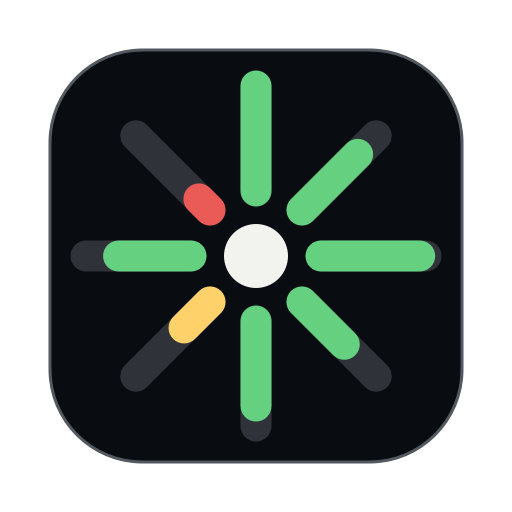
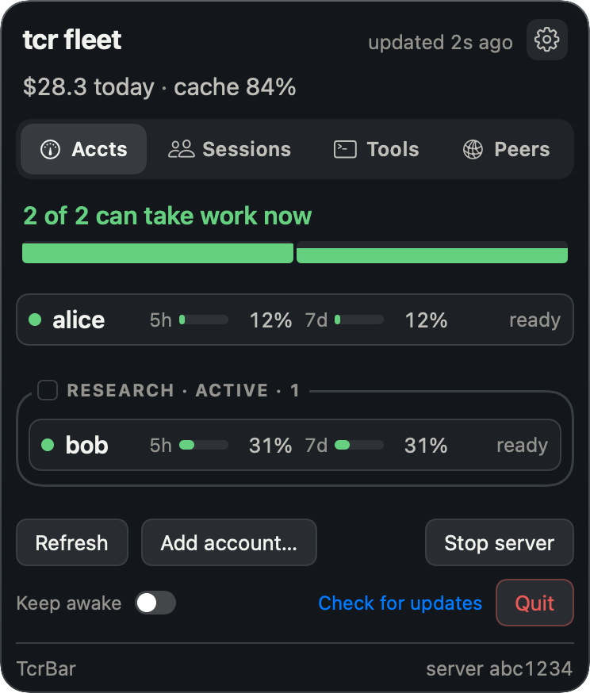
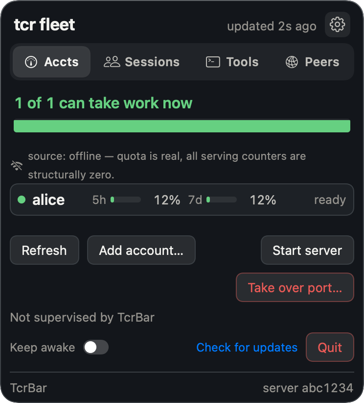
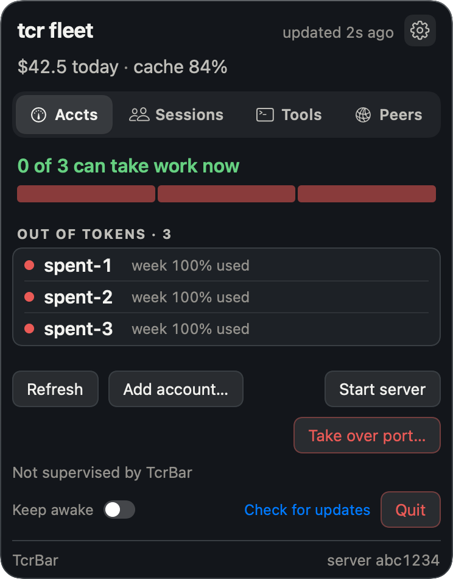
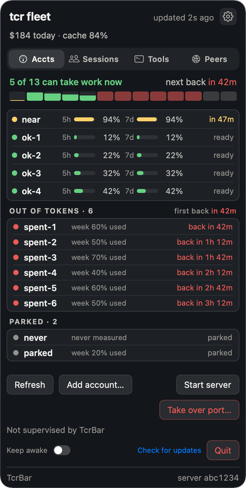
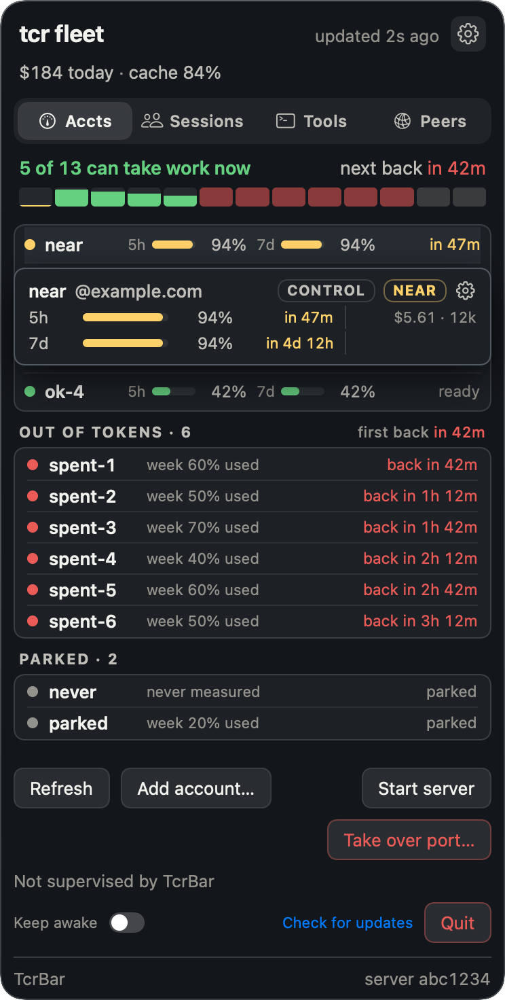

<div align="center">



# tcr

tcr (Team Capacity Router) is a local proxy that runs Claude Code across multiple Claude accounts.

Point Claude Code (or any Anthropic API client) at it. For each request it picks an account by
looking at what every account has left in every quota window. It keeps a conversation on the
account whose prompt cache is already warm, and it shows you what the traffic would have cost.

[](https://github.com/dhkts1/tcr/releases/latest)
[](LICENSE)


[Install](#install) · [Usage](#usage) · [Compared with other tools](#compared-with-other-tools) · [FAQ](#faq) · [Configuration](docs/configuration.md) · [CLI](docs/cli.md) · [Security](#security)

[](https://github.com/dhkts1/tcr/releases/latest)
[](#install)

<sub>TcrBar is a `.dmg` on the release page</sub>



</div>

## Why tcr

- **It chooses by quota, not by turn.** It reads the five-hour, weekly and per-model weekly window
  on every account, and spends first the quota that resets soonest, so less of it expires unused.
- **It keeps the prompt cache warm.** A conversation that moves to another account starts cold, and
  its next request pays at least 12.5 times as much for the cached prefix. So each conversation
  stays on one account, and on subscriptions the cache is held for an hour instead of five minutes. Over 30 days of the
  author's own traffic, ending 2026-10-13, 97.6% of prompt tokens were read from cache.
- **One proxy serves every session.** Each Claude Code session on the machine gets its own pin, and
  you can add, disable or remove accounts while it runs.
- **You can watch it.** A macOS menu-bar app and a terminal dashboard show every window, every
  session, and what the traffic would have cost at list price.
- **It stays on your machine.** No telemetry and no crash reporting. Tokens, logs and pins are
  files on your own disk.

## Install

```sh
curl --proto '=https' --tlsv1.2 -LsSf https://raw.githubusercontent.com/dhkts1/tcr/main/install.sh | sh
```

This installs the `tcr` CLI. On macOS it also installs TcrBar from the `.dmg` on the
[release page](https://github.com/dhkts1/tcr/releases/latest); set `TCR_SKIP_UI=1` to skip
that step. To install only the `tcr` CLI, on any platform, use the cargo-dist installer directly:

```sh
curl --proto '=https' --tlsv1.2 -LsSf https://github.com/dhkts1/tcr/releases/latest/download/tcr-installer.sh | sh
```

Or build from source with a Rust toolchain. Put the binary in place with the script and not with
`cp`, because [`cp` onto a running binary rewrites the same inode and macOS then kills it](CONTRIBUTING.md#installing-it-onto-your-path):

```sh
cargo build --release
scripts/install-cli.sh          # places `tcr` at ~/.local/bin/tcr by default
```

| Platform | `tcr` CLI | TcrBar menu-bar app |
|---|---|---|
| macOS, Apple silicon (`aarch64-apple-darwin`) | prebuilt | yes |
| macOS, Intel (`x86_64-apple-darwin`) | prebuilt | yes |
| Linux x86_64, musl (`x86_64-unknown-linux-musl`) | prebuilt | no |
| Linux aarch64, musl (`aarch64-unknown-linux-musl`) | prebuilt | no |
| Anything else | build from source | no |

The Linux builds are static musl binaries, so they run on both Alpine and glibc systems. TcrBar and
`tcr ui` are macOS-only.

To have a plain `claude` go through tcr, run `tcr setup shell` (a `claude` function in your shell's
startup file, for terminals) or `tcr setup claude-settings` (one key in `~/.claude/settings.json`, for
every launch, at the cost that claude cannot reach Anthropic while tcr is stopped). Both refuse
rather than overwrite a `claude` alias, function or base URL you already have, and both take
`--remove`. TcrBar asks once which you want. Details: [`tcr setup`](docs/cli.md#tcr-setup).

### Verify a download

Get `tcr` from this repository's [release page](https://github.com/dhkts1/tcr/releases)
or `install.sh` above, never a copy repackaged elsewhere: it is about to hold your account tokens.
Each CLI archive has a `.sha256` file beside it:

```sh
shasum -a 256 -c tcr-aarch64-apple-darwin.tar.xz.sha256
```

TcrBar is signed with a Developer ID certificate and notarized by Apple. The commands that check
it, and what the checksum does not prove, are in
[`docs/architecture.md`](docs/architecture.md#verifying-a-download).

### Uninstall

Stop the proxy, then delete the binary: `~/.cargo/bin/tcr` from either installer, or
`~/.local/bin/tcr` from `scripts/install-cli.sh`. On macOS, `apps/macos/scripts/uninstall.sh`
removes TcrBar and its login item.

Nothing deletes your data for you. `~/.config/tcr.json` (`~/.config/teamclaude.json` on an older
install) holds working credentials for every account in the pool, so delete it too, along with
`~/.cache/tcr/` (or `~/.cache/teamclaude/`) and any
`ANTHROPIC_BASE_URL`, `HTTPS_PROXY` or `NODE_EXTRA_CA_CERTS` you exported. Every file `tcr` keeps
is listed in [`docs/architecture.md`](docs/architecture.md#files-on-disk), and the full steps are
under [Uninstalling](docs/architecture.md#uninstalling).

## Usage

```sh
tcr login          # PKCE browser flow, once per account you want in the pool
tcr                # start the proxy with the live TUI (q quits)
tcr run -- <args>  # launch Claude Code already pointed at the proxy
```

If you already use the `claude` CLI on this machine, you can skip `tcr login` on the first run.
When `tcr status`, `tcr accounts` or the server's own boot find no accounts configured, they import
that existing login, and `tcr login --from-claude-code` does the same import on request. A refresh
token works only once, so the first time tcr refreshes the imported credential, `claude` asks you
to log in through the browser once. tcr says so on every import, and
[`docs/cli.md`](docs/cli.md) has the details.

To point a client at the proxy yourself instead of using `tcr run`:

```sh
export ANTHROPIC_BASE_URL=http://127.0.0.1:3456   # base-URL mode
# or
export HTTPS_PROXY=http://127.0.0.1:3456          # forward-proxy mode
export NODE_EXTRA_CA_CERTS=<the CA path tcr logs at boot>
```

Forward-proxy mode decrypts TLS with a locally generated certificate, so the client has to trust
it; `tcr` prints the CA path to use when it starts. The config lives at `~/.config/tcr.json`
(an install that already has `~/.config/teamclaude.json` keeps using that), and `name` and
`accessToken` are the only required keys. Every other
key, its default and the file's permissions are in
[`docs/configuration.md`](docs/configuration.md).

### Managing the fleet

Changes to the pool reach a running proxy without a restart. `enable`, `disable`, `remove`,
`priority` and `control` apply to it directly, and the proxy picks up `group` edits from the
config file on its next request. Every flag is in [`docs/cli.md`](docs/cli.md).

| Command | What it does |
|---|---|
| `tcr accounts [--probe]` | List the pool. `--probe` refreshes quota live instead of reading the file. |
| `tcr status [--json]` | Probe every account and print the fleet. `--json` is what the panel and TUI read. |
| `tcr priority <account> [N \| --first \| --last]` | Set the rotation tier. |
| `tcr enable` / `tcr disable <account>` | Take an account in or out of rotation. |
| `tcr remove <account>` | Delete an account, disabling it live first. |
| `tcr control <account> [--clear \| --show]` | Nominate the account that serves control-plane traffic. |
| `tcr group ls \| add \| rm \| reserve \| color` | Label accounts, and hold a labelled set back for traffic that asks for it. |
| `tcr run --group <name>` | Start a session that prefers one group. |
| `tcr sessions [--json]` | List the sessions the running proxy has seen in the last hour. The panel's Sessions and Tools tabs read the same feed. |
| `tcr list --json` | Print every account in claude-swap's list format, so CodexBar can show them. Never probes. |
| `tcr wrap [--days N]` | A usage report off the on-disk ledger: cost, tokens and cache-hit ratio, broken down by model, account and day. Needs no running proxy. |
| `tcr token <account>` | Print an account's access token to stdout, for piping. |
| `tcr update` | Update `tcr` in place, from the checkout or the published installer. |

## What it does

Every Claude account has several usage limits running at once: a rolling five-hour session window,
a weekly window, and a weekly window for a single model family. Each window tracks how much you
have used and when it resets, and different accounts reset at different times. `tcr` learns every
window on every account and schedules requests against them.

**It does not round-robin.** Within a priority tier it prefers the account whose quota window
resets soonest, because weekly quota you have not used is lost once that window resets. Ties go to
the account picked least recently, so requests still spread out instead of piling onto one
account. It skips an account that is disabled, erroring, on a rate-limit hold, too close to a
limit, held back for a group this request did not ask for, or out of the model-scoped window this
request needs. The full ordering is in
[`docs/architecture.md`](docs/architecture.md#account-selection). The reset-urgency rule, and how
to turn it off, is in
[`docs/configuration.md`](docs/configuration.md#reseturgencytierhours-spend-the-quota-that-is-about-to-expire).

**The prompt cache is the expensive part.** Anthropic keeps it per account, so moving a live
conversation to another account rebuilds its whole cached prefix. That is why each session is
pinned to one account and stays there. A single request that detours around a passing fault does
not move the pin; only a failure of the account itself does. Pins are saved to disk continuously
and restored at boot, so a restart does not cold-start every live conversation. Anthropic holds a
cached prefix for five minutes, or an hour if the client asks for it, and a session that asked for
the hour keeps its pin longer to match.

**Outgoing traffic is paced per organization**, because that is the unit Anthropic limits: two
accounts in one org share that org's single rate. A looser ceiling for the whole fleet sits behind
it. Quota probes are reads that spend nothing and keep an idle account's numbers current. Each
account runs them on its own random schedule, so the fleet never reaches Anthropic in one burst on
a fixed period, and a restart scatters them again instead of lining them up.

**Everything is priced.** Every request served goes into a local ledger at Anthropic's list prices,
per account and per model, split into input, output, cache reads and cache writes. The panel and
the terminal dashboard show today's spend, the burn rate over the last hour, the model mix and the
cache hit rate. The ledger reloads from disk at boot, so a restart does not reset the day. None of
this is a bill: these accounts are subscriptions, and list price is simply the one unit you can
compare across accounts, models and days. Traffic that could not be priced shows no figure rather
than a zero, an account that served nothing shows a real zero, and a window holding both reports
the priced part next to the count it could not price.

OAuth tokens refresh in the background, so accounts do not expire while you work. Accounts can
carry labels, and a labelled set can be *reserved* so only traffic that asks for it goes there. One
account can be named to serve the identity and control-plane calls a client makes alongside its
prompts; inference never picks that account, so it stays clean. You can add, enable, disable and
remove accounts while the proxy runs, which matters because a restart is what costs you warm pins.
There is a native macOS menu-bar app and a terminal dashboard.

## Watching it

`apps/macos` holds TcrBar, a native front end over the same `tcr status --json` the TUI reads. The
menu-bar item is the whole app, with no Dock icon and no window. Its icon shows the capacity left
across the whole fleet rather than the worst account, because one used-up account in a rotating
pool is the rotation working, not an alarm.

The panel has four tabs. **Accounts** has one row per account, with a line for each quota window
showing a bar, a percentage and the countdown to that window's reset. Each row also shows probe
health and group tags, and its right-click menu runs `tcr` for you, so you can steer the fleet
from the panel. **Sessions** lists the proxy's live sessions by project, and each one names the
account it runs on. **Tools** shows what is running now, today's slowest calls and totals per tool.
**Peers** shows the other Macs `tcr` has found and what is lent (see [Peers](#peers)). Sessions and
Tools read from the running proxy and keep a copy of what they last saw, so after a proxy restart
they show their last known state instead of going blank.

Account rows also show the model-scoped weekly window (Fable's, on current plans) once the proxy has
learned that window for the account; until then the spot stays empty rather than showing a zero.
The proxy enforces that window as well as showing it: a request for that model skips an account
that has used it up, and requests for any other model ignore it. The header and each card show the
spend figures, and the footer holds a keep-awake switch, Check for updates and Quit. TcrBar can also run the proxy for
you, keep the Mac awake while it does, and update itself through
[Sparkle](https://sparkle-project.org).

Install it from the [latest release](https://github.com/dhkts1/tcr/releases/latest), or run
`tcr ui`. To build it from this repo, run `apps/macos/scripts/install.sh`. How releases are made is in [`docs/RELEASING.md`](docs/RELEASING.md).

The panel never shows a blank list. It tells apart four cases, because each needs a different
response: `tcr` is missing, a poll is failing, the fleet is empty, or the read is offline.

<p>
  
  
</p>

<details>
<summary>The full fleet view, and the terminal dashboard</summary>

<p>
  
  
</p>

Every account is one line. Point at a line, or at its segment in the strip, to open its card; right-click an
account and choose Keep Card Open to leave it open.


The TUI runs on both macOS and Linux and shows everything the panel does, plus the live session
tree: which conversation is pinned to which account, and which ones diverted.

`tcr demo` runs the real TUI against fake accounts, which is how these screenshots were made. It
needs no config and contacts nothing.

</details>

## How it works

One TCP listener serves both modes. It peeks at the first eight bytes of each connection without
consuming them and decides from those. A `CONNECT` to an Anthropic API host has its TLS terminated
with a locally generated leaf certificate, any other `CONNECT` is copied through as raw bytes, and
plain HTTP is base-URL mode. Each request then runs a bounded rotation loop: pick an eligible
account, refresh its token if it is about to expire, swap the client's credentials for the pooled
one, send, and rotate to another account on a 401, 429, 529 or transport failure.

Quota numbers come from the response headers of traffic `tcr` already serves. Between requests, a
probe that spends nothing against Anthropic's OAuth usage endpoint keeps them fresh. The probe
never calls `/v1/messages`, so an idle account's bars stay accurate instead of freezing at their
last served value. A window that has passed its reset reads as fresh rather than full, worked out
against the clock at the moment it is read, so neither the display nor the scheduler can act on a
stale bar. The request-flow diagram, the selection order and the probe schedule are in
[`docs/architecture.md`](docs/architecture.md).

## Peers

`tcr` can find other Macs on your network that run `tcr`, trust them, and lend a trusted Mac part
of an account: 20 % of a group's weekly window, for example, or one account until 18:00. It is off
by default. Finding and sharing each have their own switch, and nothing is sent before you turn
one on.

The design rests on three rules. The announcement each Mac broadcasts carries a random id that
changes every boot and a port; it never carries a key, and carries a name only if you allow it.
Nobody is trusted until a person at each Mac has compared the same six digits on both screens and
pressed Trust. A borrowed request is served from the lender's own account, so the borrower's
credential never leaves the borrower's Mac and the lender never learns it.

Pairing and every peer stream run over the
[Noise Protocol Framework](https://noiseprotocol.org/noise.html). A first pairing uses `XX` (both
sides learn each other's key, and the six digits come from the handshake hash), a return visit to
a Mac you already trust uses `IK`, and `IKpsk1` is for when a join key has been passed around.
WireGuard is built on the same handshake family, and if you want to understand how any
Diffie-Hellman based authentication works, that one spec is the best hour you can spend.
[`docs/peers.md`](docs/peers.md) covers finding, trusting, lending and what each step sends.

## Compared with other tools

Several tools let Claude Code use more than one account. They differ in where they sit: a proxy in
the request path chooses an account for every request, while a switcher changes which login Claude
Code itself holds.

| Tool | How it switches | How it picks an account | Keeps each conversation on one account | Runs on | License |
|---|---|---|---|---|---|
| **tcr** | Local proxy in the request path | Every request, by what is left in the five-hour, weekly and per-model weekly windows | Yes, always; moves only when that account cannot serve | macOS, Linux | PolyForm Noncommercial |
| [claude-swap](https://github.com/realiti4/claude-swap) | Swaps Claude Code's stored login, for the whole machine or one terminal | By hand, next in turn, or automatically at a five-hour or seven-day threshold | Per terminal with `cswap run`; a switch moves the running session, which its README says rebuilds the cache | macOS, Linux, Windows | MIT |
| [teamclaude](https://github.com/KarpelesLab/teamclaude) | Local proxy in the request path | Rotates when the five-hour or weekly window reaches a threshold, and tracks the per-model weekly cap | Opt-in with `distributeSessions`, off by default | Node.js 20+ | MIT |
| [ccs](https://github.com/kaitranntt/ccs) | Launches Claude Code with a chosen profile; account pools go through a local proxy | Profile chosen at launch; the proxy rotates round-robin by default, or fills one account first with pool routing on | Opt-in: [pool routing](https://docs.ccs.kaitran.ca/features/pool) holds a conversation on one account for up to an hour | macOS, Linux, Windows | MIT |
| [Quotio](https://github.com/nguyenphutrong/quotio) | macOS app that manages a local proxy (CLIProxyAPI) | Round-robin or fill-first | Not stated in its README | macOS app; CLI on macOS and Linux | MIT |
| [cux](https://github.com/inulute/cux) | Swaps the login, restarts Claude Code and resumes the conversation | On a rate limit by default, with optional five-hour and seven-day thresholds | No: moving the conversation is how it works | Linux, macOS, Windows | GPL-3.0 |
| [cc-account-switcher](https://github.com/ming86/cc-account-switcher) | Swaps the stored login while Claude Code is closed | By hand | Not stated in its README | macOS, Linux, WSL | MIT |

Each row comes from that project's own README and docs, read on 2026-10-13. "Not stated" means its
README does not say, not that the tool cannot.

Another tool fits better if you need Windows (claude-swap, ccs, cux), want Codex, Gemini or other
providers behind the same tool (teamclaude, ccs, Quotio), want no proxy in the request path
(claude-swap, cux, cc-account-switcher), or need an open-source license for commercial use (every
other row).

## FAQ

### How do I use Claude Code with more than one Claude account?

Install `tcr`, run `tcr login` once for each account, start the proxy with `tcr` (or let TcrBar run
it), and launch Claude Code with `tcr run`. Every request then goes through the proxy, which picks
an account from the pool. If you are already logged in to Claude Code, the first run imports that
login, so you only log in to the others.

Claude Code has its own answer: `CLAUDE_CONFIG_DIR` moves its configuration directory, and
[Anthropic's docs](https://code.claude.com/docs/en/env-vars) suggest it for running accounts side
by side, as in `CLAUDE_CONFIG_DIR=~/.claude-work claude`. There you pick the account by picking
the directory when you start a session. `tcr` keeps one Claude Code setup and picks the account
for every request instead. `tcr` does not read `CLAUDE_CONFIG_DIR`: the import takes Claude Code's
default login, and [`docs/cli.md`](docs/cli.md#--from-claude-code-importing-the-login-claude-already-has)
says how to point it at another file.

### Does switching accounts lose the prompt cache?

Yes. Anthropic keeps the prompt cache per account, so a conversation that moves arrives cold and
writes its whole cached prefix again. A cache write bills at 1.25 times the input price and a cache
read at a tenth of it or less, so the first request after a move pays at least 12.5 times as much
for that prefix (25 times on Opus 5.5), and on a long conversation the prefix is nearly all of the
request. That is why `tcr` keeps each
conversation on one account, even past the point where it would send new conversations elsewhere.
It moves only when that account cannot serve the request. Pins are saved to disk, so a restart
keeps them for conversations still within the cache lifetime.

### How long does the cache stay warm?

Five minutes after its last use, unless the request asks for an hour. From 1.1.19 `tcr` rewrites
every cache breakpoint to the hour, so a conversation you come back to within the hour resumes warm
instead of writing its prefix again. On a subscription the hour costs the five-hour window what
five minutes does (measured 2026-10-06). `cacheTtlRewrite` in
[`docs/configuration.md`](docs/configuration.md) turns it off.

### What happens when an account runs out?

New conversations skip any account that is close to a limit, on a rate-limit hold, or out of the
model window a request needs, and go to the account the quota rules pick next. A conversation
already on that account moves once, and pays one cache rebuild.

### Does it run on Linux, and with API keys?

The `tcr` CLI and terminal dashboard run on Linux as static builds for x86_64 and aarch64. TcrBar,
the menu-bar app, is macOS only. Accounts are Claude subscriptions logged in through the browser;
`tcr` does not serve Anthropic API keys.

## Documentation

| Document | What is in it |
|---|---|
| [`docs/configuration.md`](docs/configuration.md) | Every config key, its type, default and source citation. |
| [`docs/cli.md`](docs/cli.md) | Every command and flag, exit codes, account resolution. |
| [`docs/peers.md`](docs/peers.md) | Finding, trusting and sharing accounts with other Macs on your network. |
| [`docs/architecture.md`](docs/architecture.md) | Request flow, entry modes, account selection, quota probes, files on disk, verifying a download, uninstalling. |
| [`docs/troubleshooting.md`](docs/troubleshooting.md) | Symptoms and what they mean. |
| [`CONTRIBUTING.md`](CONTRIBUTING.md) | Development setup, test and lint gates, what `main` requires. |

## Security

Read this before you run it.

**Listening only on localhost does not keep other programs out.** `tcr` binds `127.0.0.1`, but
every process and container on the host can reach loopback. The forwarding path does not ask
loopback callers for the API key, and nothing creates a `proxy.apiKey` for you, so on a default
install the only check is being on this host. Set a key if you want a tighter boundary than that.

**The forward proxy is an open tunnel on purpose.** Its allowlist of hosts it may decrypt has three entries:
`api.anthropic.com`, `console.anthropic.com` and `platform.anthropic.com`. Every other `CONNECT`
target is copied through as raw bytes and is never decrypted or filtered, which makes `tcr` an
unrestricted forward proxy to any host for any local process. Claude Code needs it to work that
way, so treat it as a tunnel and not as a firewall. Which hosts are actually decrypted depends on
the leaf certificate in use, and [`MITM-DESIGN.md`](MITM-DESIGN.md) works through that.

**Credentials.** On the two inference paths, `tcr` drops the client's own `authorization` and
`x-api-key` headers before adding the pooled Bearer token, so a client credential is never sent
alongside ours. Everything else a client sends under its own bearer (connector list, plugins,
settings, bootstrap) is relayed under that bearer unchanged, because those calls are about the
client's identity. The proxy checks that identity against `controlAccount` (see `controlIdentity`
in [`docs/configuration.md`](docs/configuration.md)).

`git config core.hooksPath .githooks` turns on a pre-commit secret scan and the other gates
listed in [CONTRIBUTING.md](CONTRIBUTING.md#git-hooks). Treat it as a backstop: it only sees what
you stage, and `--no-verify` exists.

**Peers are opt-in twice and rate-limited.** Nothing is announced until `find` is on, and nothing
is served until `share` is on. A Mac that wants to pair knocks with temporary keys only and waits
in a list until you accept it. Knocks are capped per address (one every 10 s, a burst of 3, two
unauthenticated sockets), and the list holds eight. An address you ignore is muted. One you block
is banned by address and, once its key is known, by key. A lender sees the plaintext of the
requests it serves, by design, and lends at most half of any window.
[`docs/peers.md`](docs/peers.md#what-leaves-this-mac) has the full table of what each step sends.

Found a security issue? Please report it privately through GitHub's security advisories rather
than in a public issue.

## It does not phone home

`tcr` has no telemetry and no crash reporting. Your config, logs, session pins and OAuth tokens are
files on your own disk. It makes two kinds of outbound call: to Anthropic on your behalf, and to
GitHub to check for a newer version.

The cost falls on whoever hits a bug. There is no error stream to search and no session to replay,
so a good bug report is worth more here than in a project that watches its users. #323 was
diagnosed from a screenshot and four log lines someone pasted.

Instead of watching you, it signs things. The app is codesigned with a Developer ID certificate,
notarized by Apple and stapled, and every update is signed again with a Sparkle EdDSA key that your
installed copy checks before it runs anything. Counting them all, there are seven signing secrets
for the release, all deliberately removed from this repository on 2026-08-09 and now kept on one
Mac and in one 1Password item. On top of those come a local CA on your machine that mints a fresh
leaf certificate on every boot, your per-account OAuth tokens, and the proxy's own API key.

That is a lot of keys for a tool that rotates Claude accounts. The reasoning is in
[docs/RELEASING.md](docs/RELEASING.md): this repository is public, collaborators have push access,
and Sparkle's private key does more than protect a build artifact. It decides what every copy
already installed will run. A key that is not stored here cannot be stolen from here.

## License

Licensed under PolyForm Noncommercial 1.0.0; see [`LICENSE`](LICENSE).
